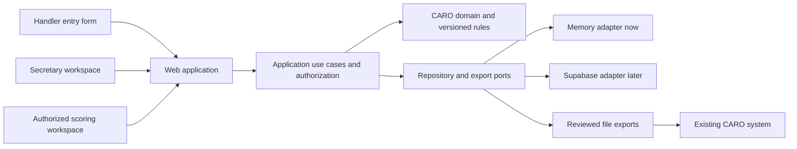

# Architecture

## System boundary

Build an independent modular monolith. Reuse secretary workflow ideas, with a CARO-specific domain. Keep UI, business rules and persistence separate so local domain tests run without hosting credentials.

The baseline is a standalone trial secretary: setup, entries, scheduling, trial-day results, finances and reviewed reporting. It must function with no historical results or external registry access. Capture entrant-supplied CARO IDs and eligibility declarations with provenance and staff review. Keep declaration, local validation and official verification visibly distinct. Historical progress and title calculations are optional future modules, not baseline dependencies.

The export arrow represents a human-reviewed file transfer, not an existing API. Vercel will host the web layer after the user provisions a project. Supabase will provide Auth, PostgreSQL and private storage. No services have been created.

## Modules and ownership

| Module | Owns | Key behavior |
| --- | --- | --- |
| Identity/access | User profiles, club memberships, trial assignments | Deny by default; administrator, club administrator, secretary, assigned scorer/judge permissions. |
| Reference/rules | Source documents, rule bundles, Rally levels/formats/streams, Working exercises, judge authorizations | Effective-dated immutable versions; drafts cannot issue official decisions. |
| Trial applications | Host, chair, secretary, venue, mode, timezone, days, official event rows | Order assigns official round number before finalization. Afterwards preserve judge/number snapshot. |
| Premium builder | Club templates, trial-derived premium drafts, public editions and PDF snapshots | Uses trial/application/fee data; review and versioned publication; source changes mark editions stale. |
| Dog-ID entry assistance | Public CARO lookup adapter, source timestamps, entrant confirmations | Supported public information only; manual fallback; no ownership, eligibility or complete-history assumption. |
| Scheduling | Rings, sessions, run order and conflicts | Schedule changes never renumber official events. Detect handler/dog conflicts across multi-participant entries. |
| Registry | Local handlers, dogs, CARO IDs, provenance | Dog ID is text. Local records do not create official registration; duplicate matches require review. |
| Entries | Entry orders, entry lines, participants, selections, waivers, move-ups, withdrawal | One event entry can reference several dog/handler participants. Working selections belong to individual exercises. |
| Scoring | Performance attempts, score revisions, exercise outcomes, judge sign-off | Draft -> reviewed -> finalized. Corrections append revisions and reopen affected exports/progress. |
| Finance | Fee snapshots, charge lines, payments, allocations, refunds, waivers, expenses | Integer CAD cents; immutable ledger and reversals, not overwritten balances. |
| Reporting | Running orders, score sheets, entry and finance reports, result packages | Versioned output snapshots; sensitive exports private; report format compliance verified before use. |
| Progress (optional future module) | Verified historical results and provisional calculations if data becomes available | Not required for trial-secretary operation; preserve source and distinguish estimates from official titles. |
| Audit/outbox | Actor, action, before/after, reason, aggregate revision, integration jobs | Atomic with primary write; retries use idempotency keys; no secrets in audit payloads. |

## Key decisions

1. **Official identity is separate from execution order.** Each application event receives a stable local ID, official round number and judge. Reordering a draft application changes numbers; scheduling a finalized application does not. A correction to an official assignment requires a distinct approved amendment workflow and evidence, never silently unlocking the snapshot.
2. **Rally and Working use distinct result structures.** Rally stores a performance result for a participant group. Working stores one outcome for each selected exercise and level, including exercise-level move-ups. Team and Brace use participant records rather than columns named dog1/dog2. Exact composition comes from verified rules.
3. **Rules are data with provenance.** A bundle includes source references, effective interval, mode applicability, review status and a content hash. A trial pins a bundle. Corrections use a new version and explicit recalculation, never mutate rules underneath historical scores. No current thresholds have been guessed.
4. **One authentication system.** Use Supabase Auth later. Avoid stacking another auth framework. Application authorization checks club membership and trial assignment; PostgreSQL RLS independently enforces the same boundaries. Browser clients never receive privileged keys.
5. **Explicit infrastructure adapters.** Core modules do not import Next.js or Supabase. The current memory repository is disposable. Future persistence maps commands to database transactions and compares aggregate revisions. No live data is stored in server process memory on Vercel.
6. **Online-first scoring with conflict detection.** Initial release saves every score with an expected revision and an idempotency key. Display persisted acknowledgment before marking it saved. Print fallback sheets. Full offline synchronization is a later feature requiring durable local queues, recovery and conflict resolution.
7. **No autonomous official submissions.** Result exports are checked and signed off by a secretary. Integration requires an authorized contract and format verification. Official dog/title records remain external.

## Workflows and state

Trial application and premium builder are first-release features. Dog-ID results assistance is also in scope, with a manual link fallback until automatic retrieval is verified. Detailed flows and acceptance criteria are in [application-premium-lookup.md](application-premium-lookup.md).

The supplied Officials Guide adds application lead-time checks (six weeks Rally/combined; three weeks Working-only), a strict approval-and-trial-number gate before any public premium publication, accommodation decisions, course-approval tasks and judge-signed post-trial paperwork. See [download-review.md](download-review.md). Store the original assigned judge, actual officiating judge and official reporting attribution separately for permitted substitution cases; do not silently replace the locked assignment. Model bye participants explicitly. Reported title declarations do not require historical tracking.

Application: draft -> finalized. Finalization requires event rows with judges and freezes the submission snapshot; it neither sanctions nor publishes a trial. Track CARO sanction status/reference separately as pending/approved/rejected with evidence. Trial operations: draft -> entries_open -> entries_closed -> running -> reviewed -> completed; cancellation is explicit. These are proposed product states, independent of CARO terminology.

Entry: submitted -> pending_review -> accepted/waitlisted/rejected; accepted -> withdrawn or checked_in. Capacity acceptance and fee creation occur in one transaction. A signed public entry token allows submission and only that entrant's receipt. Do not expose handler lookup or the dog registry to anonymous users.

Move-up: request records original event/exercise, proposed destination, request time and evidence; authorized approval checks pinned rules, capacity and scoring state. Preserve old fee/result history and the approval reason. Never rewrite a finalized result into a new class.

Scoring: select event -> verify participants -> record draft -> validate using pinned rules -> review/sign-off -> finalize. Missing verified rules returns a blocked decision, never a default pass. A secretary can document historical/manual information with provenance, but that is not an automatically verified official outcome.

## Application contracts

Commands carry authenticated actor context, club ID, aggregate ID, expected revision and idempotency key. Client-supplied role names are never trusted. A future HTTP adapter obtains identity from the server session. Validation errors map to 422, access denial 403, missing resources 404 and revision conflicts 409, without leaking other clubs' details.

Initial implemented command: `finalizeApplication({ actor, trialId, expectedRevision })`. It enforces club authorization, reads a draft, finalizes it and writes an audit event atomically through the repository port. A future transport adds request-level idempotency before exposing this publicly. The current memory adapter is a local development tool, not a security boundary or distributed transaction implementation.

Future commands: CreateTrial, AddApplicationEvent, ReorderDraftApplication, SetScheduleOrder, PublishEntryWindow, SubmitEntry, ReviewEntry, ApproveMoveUp, RecordScore, FinalizeResults, CorrectScore, RecordPayment, ReversePayment and GenerateResultPackage. Queries provide role-filtered trial dashboards, running orders, entrant balances and progress with provenance. Public and secretary responses use separate projections.

## Deployment, privacy and recovery

- All timestamps use UTC; trial days and closing deadlines are interpreted in a stored IANA timezone. Display CAD cents as currency; keep official identifiers as text.
- Future RLS applies to every club-owned table and storage object. Composite foreign keys prevent cross-club relationships. Test access with two clubs, assigned and unassigned staff, authenticated handlers and anonymous users before connecting production data.
- Public intake uses server-side validation, rate limiting, expiring scoped tokens and abuse protection. Minimize accommodation details; keep them private to staff who need them. Redact contact details from public result views.
- Private exports get expiring download links. Use a storage/outbox worker for large exports rather than depending on a long serverless request. No participant PII in logs or URLs.
- Secrets belong in local ignored environment files and hosting secret settings. Preview environments must not connect to production records or send real messages.
- Choose a Supabase region and retention policy with the user before provisioning. Define backup frequency, restore procedure and recovery objectives before launch; conduct a restore rehearsal. Do not claim Canadian-only storage without checking all providers.
- Trace command/request IDs, revision conflicts and export failures; record event counts without dog-owner details. Health checks verify connectivity without exposing secrets.

## Boundaries of this delivery

Implemented: class vocabulary, draft application renumbering, finalization lock, independent scheduling, fail-closed rule gate, authorized finalization use case, transactional memory repository and behavioral tests. The local premium studio adds editable live preview, colour palettes, club template reuse, browser draft storage, JSON backup/restore, HTML export, print styles and reviewed edition snapshots with approval/review gates.

The local trial application UI is implemented with a shared trial-to-premium projection, multi-day event dates, local finalization, separate recorded sanction status, activity history and an HTML preparation summary. Application backups validate the frozen snapshot when restored. Legacy premium data migrates to a draft trial, keeping old editions.

Designed only: persistent relational storage, full lifecycle, entry processing, payments, scoring, title calculations, official result imports/exports, RLS and hosted deployment. Automatic in-app PDF generation remains future work; current PDF output uses browser printing. Sample and long-content pagination have been rendered and visually checked using the PDF skill workflow. The premium event list is read-only and managed by the application wizard; local finalization never submits to CARO. Formal amendments and automated class/stream/judge eligibility validation are not implemented. Database/model.md is a logical schema, not an executable or production-approved migration.

## Implemented local operations adapter - October 18, 2026

src/domain/secretary.js owns entry/financial/result operations. src/adapters/local-records.js serializes optimistic revisions and commits JSON through an atomic replacement; exceptions preserve the previous file. src/local-api.js exposes loopback-only JSON endpoints, public projections, optional cached CARO read-only results, and a ReportLab fillable PDF subprocess. web/entry-form.js shares intake between public-style and staff paper/email flows. web/desk.js and reports.js present operations and exports. No private contact/accommodation fields enter public trial/receipt responses.

The browser planning record and server operational ledger are separate backup units. Prepared forms pin approved premium/fee snapshots; changed configuration makes a new trial snapshot rather than repricing existing entries. Result corrections append revisions until an event's signed Trial Record is completed; then score/order changes are locked. Eligibility/title decisions are not inferred from missing historical data.

This local adapter is deliberately unauthenticated and must stay on loopback. The hosted replacement requires Supabase authentication, club-level RLS and transactional constraints before public Vercel access. Local filesystem storage and PDF cache are not suitable as Vercel durable storage; use database records and protected object storage/generation.
