# CARO Trial Secretary

##manual-subtitle## From trial setup to published premium, judge sheets and scores

Reviewed October 27, 2026. A practical guide to the current CARO Secretary workspace.

Open the program at **https://carosec.vercel.app/**. Work through the setup chapters in order. On trial day, go directly to **Running orders**, **Judge score sheets**, then **Score entry & sign-off**.

> **What publication means today:** this release publishes the approved premium and downloadable paper/email entry form. Live online entry submission is disabled. The online form is available as a private, read-only proof.

**Your route through the program**

1. Create the club/trial and save its identity.
2. Set prices, FEO availability, days, classes, rounds and judges.
3. Prepare the premium and proof both entry forms.
4. Lock the round details, apply separately to CARO, then record actual approval.
5. Review the official entry setup and publish the premium/paper form.
6. Record and accept entries; save the running order.
7. Download and print judge working sheets.
8. Transcribe judge results, review corrections and record sign-off.

**About the illustrations:** browser screenshots show current application controls with fictional data in an isolated training workspace. TRAINING-001 is not a real CARO approval. The screenshot trial has two sample rounds; your own trial retains its full round list. No live trial was changed to make this guide.

Use the PDF bookmarks to jump between chapters. Button names in bold match the workspace.

## 1. Before you start

1. Sign in using your own account. Under your club, choose **Create trial**, or choose **Open trial** for an existing trial.
2. If the club is missing, use **Add a club** when authorized to create it. Otherwise ask your administrator to check your active club membership and trial assignment.
3. Check the trial name in the sidebar and banner before every entry, fee or score change.
4. Gather the dates, venue, officials, judges, offered classes, fees, host policies and entry agreement before starting.
5. For training, use **Start fictional practice trial**. Practice mode stays private permanently; create a separate real trial for publication.

> A practice trial cannot be converted into a real trial or published. Never enter invented approval details into a real trial.

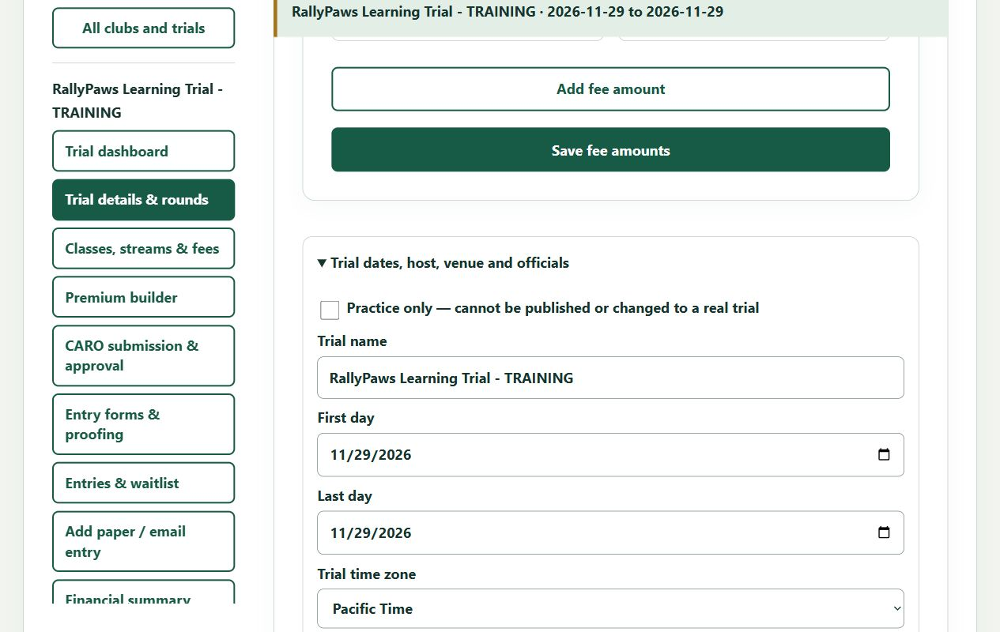

## 2. Create and save the trial

1. Under the correct club, choose **Create trial**.
2. Expand **Trial dates, host, venue and officials**. Enter the trial name, first day, last day and **Trial time zone**. For a Kelowna trial, select **Pacific Time**.
3. Enter the host, organizer, professional membership reference, secretary and chair, with their contact information.
4. Complete the venue name/address, ring surface and dimensions. Record relevant nearby-trial or permission notes.
5. Choose **Save trial draft**. Wait for the saved confirmation. A new trial must be saved once before its fee amounts can be saved.
6. Reopen the trial and check the saved identity. Complete rounds and review checks in the following chapters.

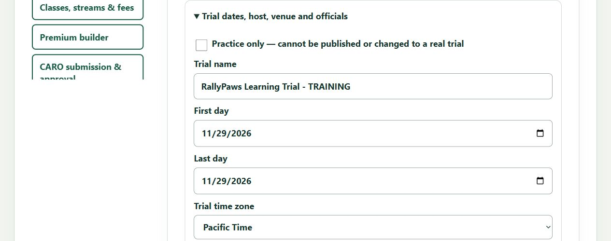

## 3. Set prices and decide whether FEO is offered

1. Open **Trial details & rounds**. **Entry fees** appears near the top.
2. Enter the **Regular Rally price (CAD)** and the **FEO price (CAD)**. Select **Offer FEO for this trial** only when the host offers it. A stored FEO price alone does not enable FEO.
3. Add separate Team, Brace or Working prices when needed. Expand **Fee description and charging unit** to check the fee's purpose and unit.
4. Choose **Save fee amounts**. Premium builder uses these same saved fees.
5. Individual round prices and FEO exceptions are reviewed in **Classes, streams & fees**.

> Example amounts are $24 regular and $16 FEO. Use your host's actual prices. Confirm whether Team/Brace pricing is per dog or per group; Working setup uses per-exercise pricing.

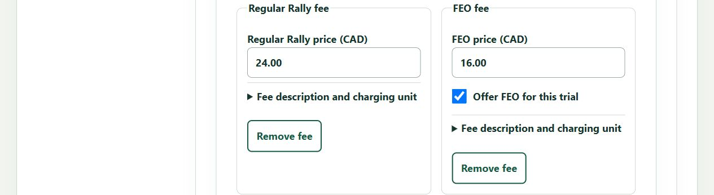

## 4. Build each day's rounds and assign judges

1. In **Trial details & rounds**, select the day tab you want to organize.
2. Under **Add a class to this day**, choose the class, format and number of new rounds. Choose **Add class rounds**.
3. For an existing class group, change **Rounds** and select **Apply round count**. Reducing the count removes that group's last draft rounds.
4. Expand each round card and enter its judge. Check the event date and class/format. For Working, enter the offered levels and exercise names explicitly.
5. Use the class **Move up/Move down** arrows to set the day's order. Check the other day tabs, then choose **Save trial draft**.
6. Count all saved rounds and reopen them to verify every judge. Do this before locking the trial.

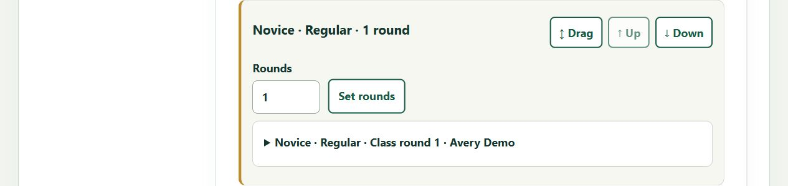

## 5. Review streams, FEO and round exceptions

1. Open **Classes, streams & fees**. Regular prices fill from the trial defaults. Team, Brace and Working retain their own fee types.
2. Novice and Intermediate display **B** automatically. For other Rally classes, check the B/C streams the host actually offers. FEO is a separate choice, not a stream.
3. Use **Offer FEO for this round** for an exception, or **Offer FEO on all rounds** for a bulk change. **Apply trial defaults to all rounds** replaces the current round exceptions with the defaults.
4. Expand **Price and capacity exceptions** only when needed. Check the selected regular/FEO prices, charging unit and capacity.
5. Use **Preview current entry form and paper PDF - without saving** to proof current choices. Return and edit them as needed, then choose **Save draft classes, streams and fees** when satisfied.

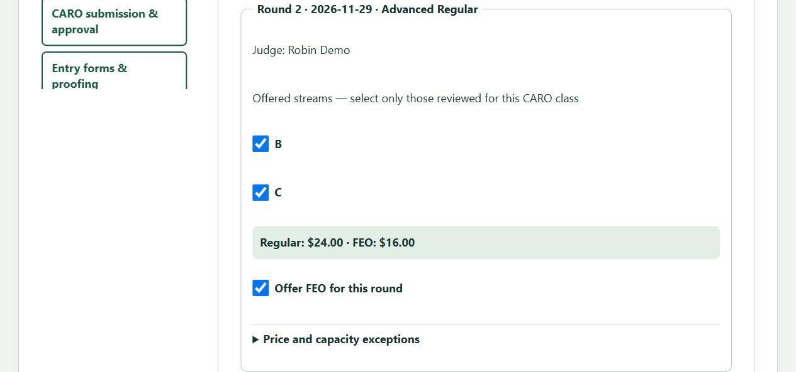

## 6. Prepare the premium

1. Open **Premium builder**. Check the saved host, dates, venue, officials and scheduled rounds shown at the top. Correct these in **Trial details & rounds** if needed.
2. Enter **Entries open**, **Entries close**, entry-limit wording and the trial-day schedule.
3. Complete payment/confirmation instructions, facilities, accommodations, awards, move-ups, refunds, site rules and the reviewed host agreement.
4. Check the fee cards and FEO setting. They share the same saved price records as Trial details.
5. Review the private premium preview, then choose **Save premium draft**. You may download **Download private premium HTML** for private review.
6. If remembered answers appear, review them for this trial. A frozen private review copy is an archive, not a publication.

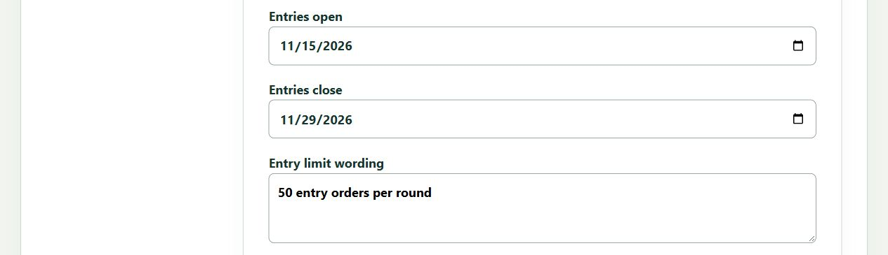

## 7. Proof the online and paper entry forms

1. Open **Entry forms & proofing**, or the premium's private testing links.
2. Check the trial identity, dates, all expected rounds, judges, streams, regular/FEO prices and charging units. Verify your own trial's full round count; training illustrations show fewer sample rounds.
3. The online proof is deliberately read-only. It cannot create an entry, accept an agreement, record payment or perform a results lookup.
4. Choose **Download fillable paper / email entry PDF - PRIVATE PROOF**. Open the PDF, try its fillable fields, save a local copy and reopen it.
5. Paper round cards show their header and priced Regular/FEO boxes. B/C offerings use separate stream cards, with one choice per round. Working exercise selections appear separately.
6. Return to setup for corrections and proof again. Private proof files are not entry forms to distribute to entrants.

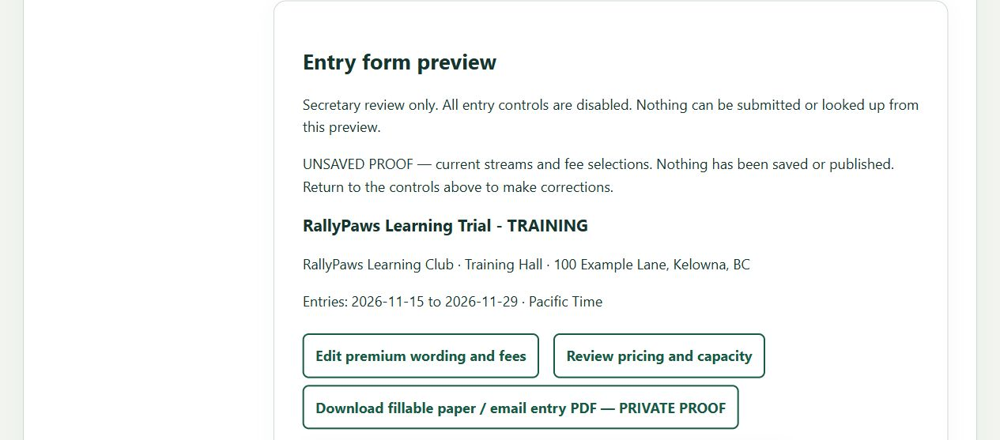

## 8. Lock the rounds and record actual CARO approval

1. Save the trial, fee and stream changes. Review the membership, judge, class/format and nearby-trial permission checks in **Trial details & rounds**.
2. Choose **Lock trial details and rounds** and confirm only after checking the complete schedule. The dates, official round order and judges then become locked.
3. Use **Open official CARO application** to complete and submit the actual application separately. Preparation downloads and the transfer helper do not submit it for you.
4. Open **CARO submission & approval**. Record **submitted**, the actual submission date and a real confirmation/evidence reference. Select **Record completed CARO action**.
5. After approval is received, return and record **approved**, the assigned CARO trial number and actual decision evidence. Keep the submission date accurate.

> Locking, recording approval and publishing are separate actions. Do not enter a made-up approval or trial number to unlock publication.

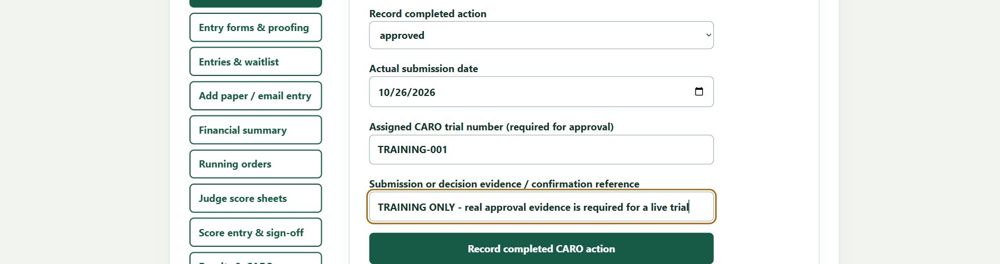

## 9. Save the reviewed official entry setup

1. After locking the rounds, reopen **Classes, streams & fees**. The heading now reads **Entry pricing and capacity**.
2. Review the prefilled prices, FEO availability, fee basis and capacity for every official round. Resolve any blank or changed values.
3. Enter **Reviewed agreement version / reference** for the host agreement being issued.
4. Select **I reviewed the agreement, each fee basis, FEO availability and event capacities.** Then choose **Save private entry setup**.
5. If you subsequently change the premium, revisit and review entry setup before publication. After entries exist, their recorded prices and agreements stay frozen.

## 10. Publish the premium and paper form

1. Check that the real trial is locked, actual CARO approval is recorded, the premium is saved and official entry setup is reviewed.
2. In **Premium builder**, find **Public premium and paper entry form**. Enter a readable **Public link name** using lowercase letters, digits and hyphens.
3. Choose **Review public premium**. Read the exact public preview, including officials, prices and agreement.
4. Select **I reviewed these exact public terms, officials, fees and host agreement.** Choose **Publish reviewed premium**.
5. Follow **Open published premium and paper entry download**. Verify the public premium and download its paper form; check the email return instructions before sharing the link.
6. **Close public listing** closes access to the listing; it does not erase received entries or their terms.

> This release publishes premium and paper/email entry information only. The private online form can be proofed, but live online submission remains disabled.

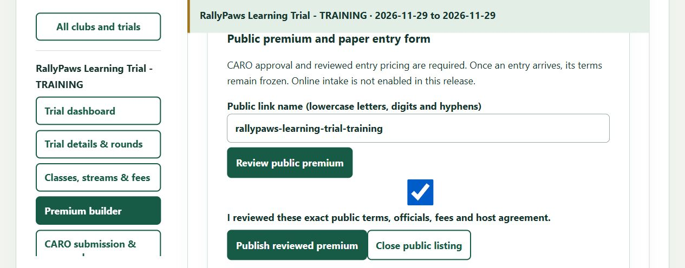

## 11. Receive and accept entries before printing

1. Open **Add paper / email entry** and transcribe the entrant's signed form. Choose the received channel, preserve its evidence reference and record the original receipt time when known.
2. Check the handler/dog details, CARO ID, selected rounds, stream, FEO, jump height and any partner dog. Record the entrant's declarations from the signed form.
3. Choose **Record entry**. Note its saved reference; receipt is not acceptance or payment.
4. Open **Entries & waitlist**, find the entry and choose **Review entry**. Review and accept, waitlist or reject each round separately. Waitlisted/submitted runs do not belong in the active judge packet.
5. Record actual receipts separately in **Financial summary**. The program records money received; it does not collect or transfer money.

> If you record a withdrawal, preserve the reason and review refunds/waivers separately. Withdrawal does not erase earlier charges or payment history. Accepted/check-in runs, rather than every submitted entry, drive the trial-day list.

**Before trial day:** reconcile the accepted entries, round capacities, dog IDs, streams, FEO choices, judges, jump heights, accommodations and required partner information.

## 12. Set and save the running order

1. Open **Running orders**. Select the correct **Official round**, date and class. Use **Refresh round** to reload current saved information.
2. Check each accepted/check-in run and its dog ID, handler, FEO status and jump height.
3. Use **Move up/Move down** to arrange the competitors. Choose **Save running order** before printing.
4. Repeat for each official round. Running-order changes do not renumber the trial's official rounds.
5. If entry decisions or judge assignments change, refresh, verify the order again and print fresh affected sheets as needed.

## 13. Download and print judge score sheets

1. Open **Judge score sheets** and choose the correct **Official round**.
2. Set **First running-order number** to 1 for the beginning of that round. Set **Number of sheets (up to 100)** for the range needed.
3. Select **Download judge working sheets PDF**. For a long round, download additional ranges; for example, start at 101 for the next batch.
4. Open the downloaded PDF. Check the trial/round, attending judge, dogs, CARO IDs, streams, FEO and jump heights against the saved order.
5. Use the PDF viewer's Print command, select Letter paper and review print preview. Use actual size/100% when it fits your printer's margins; print one sheet first to verify legibility and no clipping.
6. Repeat for every round. Keep the judge's completed/signed records for score transcription.

> These are judge **working** sheets. Verify their suitability against current official CARO forms, especially Working layouts. If there are no active accepted runs, the button downloads a **blank round verification PDF**, not a competitor packet.

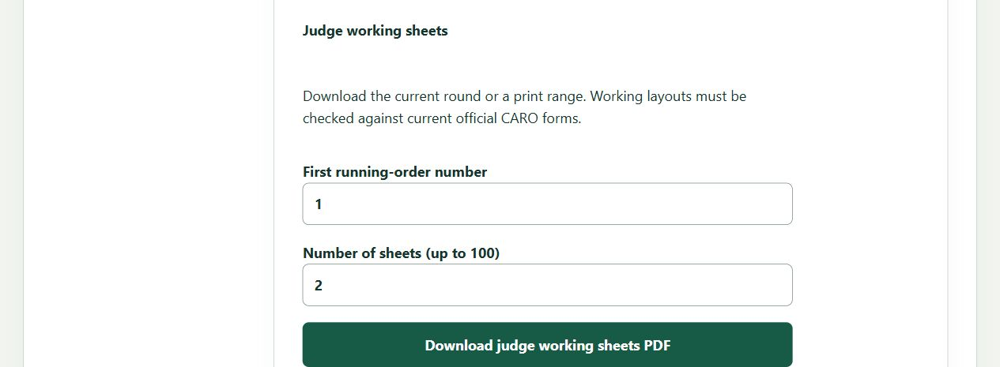

## 14. Enter Rally judge results

1. Open **Score entry & sign-off**, select **Official round**, and match the dog/CARO ID to the judge's sheet.
2. Choose **Record judge result** for that run. Copy **Judge outcome** exactly: Q, NQ, FEO, Absent or Excused as applicable. FEO-entered runs have a restricted outcome list.
3. Copy **Rally score (whole number 0-200)** when provided. A Q requires a score; do not calculate Q/NQ from the number yourself.
4. Enter **Elapsed seconds from the judge record**. This is required. If the judge record has no elapsed time, clarify the record before saving; do not invent a time.
5. Add an optional recording note, check the transcription confirmation and choose **Save judge result**. Verify the saved result on the run card, then continue with the next dog.

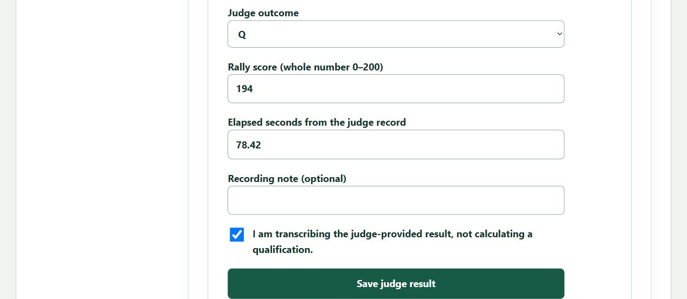

## 15. Working results and corrections

**Working rounds**

1. Select the Working official round and choose **Record judge result** for the correct dog.
2. For every exercise entered, copy the judge's outcome: Pass, Not Yet, FEO, Absent or Excused as offered by the screen. FEO-entered runs have a restricted list.
3. Enter the judge-recorded elapsed seconds, confirm transcription and save. Do not convert exercise outcomes into a Rally score or combine them with Rally Q counts.

**Correct a transcription before sign-off**

1. Choose **Review / correct result** on the saved run.
2. Compare the current version with the judge's record; correct the outcome/score/time and enter the required **Correction reason**.
3. Check the transcription confirmation and choose **Record correction**. Verify the new result. Prior versions remain in history; do not delete or overwrite database rows.

## 16. Review, sign off and retain records

1. Record a result, absence or excusal for every active run in the round. Until then, the screen reminds you that results are missing.
2. Reconcile the latest results and all corrections against the judge's completed/signed record. Check the judge attribution, dog IDs, streams and FEO designations.
3. When **Review and complete this event** appears, enter **Judge sign-off evidence / signed record reference**. Choose **Record reviewed event sign-off** only after review is complete.
4. Sign-off locks further run, order and result changes for that event. Complete each round separately. Resolve uncertainties before sign-off; there is no ordinary edit button after completion.
5. Use **Results & CARO closeout** for working reports/CSV exports and actual post-trial tracking. Verify the current official CARO submission forms separately. Recording dates does not send paperwork or payment.

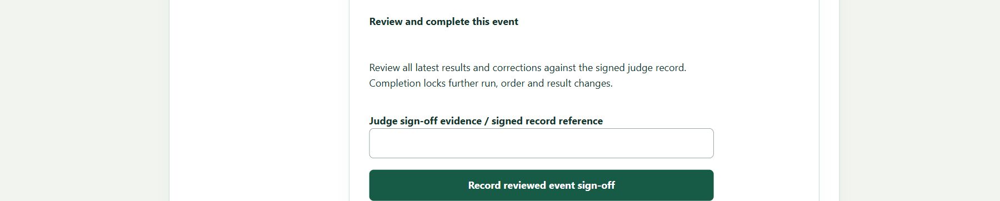

## 17. Quick checks when something is missing

**I cannot publish.** Check real-versus-practice mode, locked rounds, actual CARO approval/trial number, saved premium, reviewed official entry setup, then Review public premium and its confirmation checkbox.

**The price is blank or pending.** Check the trial's regular/format-specific fee card, its purpose and charging unit. Resolve ambiguous defaults or choose a round exception. Refresh the proof after edits.

**FEO has a price but no entrant choice.** Enable it for the trial/default or relevant round. A fee amount by itself is not an offering. Recheck the proof and save the intended round setup.

**The sample has fewer rounds than my trial.** Manual pictures use a small training dataset. Download your trial's own fresh proof to verify its complete list; extra B/C stream cards do not create extra official rounds.

**A dog is missing from judge sheets.** Confirm the run is accepted/check-in, the correct round is selected, the print range includes it and the round/order has been refreshed.

**The PDF is blank.** No active accepted runs produces a blank verification sheet. It does not mean the trial source was deleted.

**I cannot edit a result.** Check whether that round has been signed off. Use transcription corrections before sign-off and the reviewed process for later issues; do not bypass locks in database tables.

**A save reports another change.** Preserve your pending details, refresh/reopen and compare current records before retrying. Check the Activity journal if an earlier request's outcome is uncertain.
